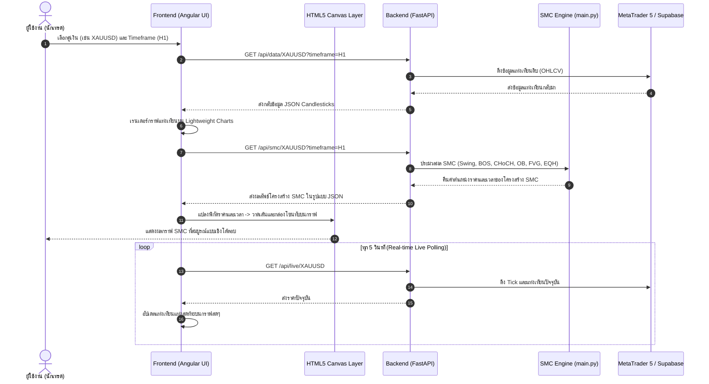

# 📖 คู่มืออธิบายการทำงานของระบบ (Codebase Documentation)
**โครงการ: ระบบวิเคราะห์และทดสอบกลยุทธ์โครงสร้างตลาดด้วย Smart Money Concepts (SMC Backtest Engine)**

---

## 📌 สารบัญ (Table of Contents)
1. [ภาพรวมสถาปัตยกรรมระบบ (System Architecture Overview)](#1-ภาพรวมสถาปัตยกรรมระบบ)
2. [ส่วน Backend (FastAPI & Data Ingestion)](#2-ส่วน-backend-fastapi--data-ingestion)
   - [2.1 โครงสร้างไฟล์ใน Backend](#21-โครงสร้างไฟล์ใน-backend)
   - [2.2 การเชื่อมต่อข้อมูล (Data Sources: MT5 & Supabase)](#22-การเชื่อมต่อข้อมูล-data-sources-mt5--supabase)
   - [2.3 รายละเอียด API Endpoints](#23-รายละเอียด-api-endpoints)
3. [เจาะลึกลอจิกอัลกอริทึม SMC (SMC Core Algorithmic Logic)](#3-เจาะลึกลอจิกอัลกอริทึม-smc-ไฮไลต์สำคัญ)
   - [3.1 การคำนวณ ATR (calc_atr)](#31-การคำนวณ-average-true-range-calc_atr)
   - [3.2 การตรวจจับจุดกลับตัว Swing (detect_swings)](#32-การตรวจจับจุดกลับตัว-swing-high--swing-low-detect_swings)
   - [3.3 การวิเคราะห์โครงสร้างราคา BOS และ CHoCH (detect_structure)](#33-การวิเคราะห์โครงสร้างราคา-bos-และ-choch-detect_structure)
   - [3.4 การตรวจจับ Order Blocks และการเช็ค Mitigation (detect_order_blocks)](#34-การตรวจจับ-order-blocks-และ-mitigation-detect_order_blocks)
   - [3.5 การตรวจจับ Fair Value Gap (detect_fvg)](#35-การตรวจจับ-fair-value-gap-fvg-detect_fvg)
   - [3.6 การตรวจจับ Equal Highs / Lows (detect_equal_highs_lows)](#36-การตรวจจับ-equal-highs--lows-liquidity-pools-detect_equal_highs_lows)
   - [3.7 การคำนวณโซน Premium / Discount (detect_premium_discount_zones)](#37-การคำนวณโซน-premium--discount-detect_premium_discount_zones)
   - [3.8 การระบุ Strong / Weak High-Low (detect_strong_weak_hl)](#38-การระบุ-strong--weak-high-low-detect_strong_weak_hl)
   - [3.9 ระบบ Multi-Timeframe Scoring & Dashboard Logic (get_dashboard)](#39-ระบบ-multi-timeframe-scoring--dashboard-logic-get_dashboard)
4. [ส่วน Frontend (Angular & TradingView Lightweight Charts)](#4-ส่วน-frontend-angular--lightweight-charts)
   - [4.1 โครงสร้างไฟล์ใน Frontend](#41-โครงสร้างไฟล์ใน-frontend)
   - [4.2 Service เชื่อมต่อ API (market-data.ts)](#42-service-เชื่อมต่อ-api-market-datats)
   - [4.3 คอมโพเนนต์หลักและการเรนเดอร์กราฟ (app.ts)](#43-คอมโพเนนต์หลักและการเรนเดอร์กราฟ-appts)
   - [4.4 เทคนิค HTML5 Canvas Overlay ซ้อนบนกราฟแท่งเทียน](#44-เทคนิค-html5-canvas-overlay-ซ้อนบนกราฟแท่งเทียน)
   - [4.5 การทำงานแบบ Real-time Live Polling](#45-การทำงานแบบ-real-time-live-polling)
   - [4.6 หน้า Dashboard และ Market Matrix](#46-หน้า-dashboard-และ-market-matrix)
5. [สรุป Flow การทำงานตั้งแต่ต้นจนจบ (End-to-End Data Flow)](#5-สรุป-flow-การทำงานตั้งแต่ต้นจนจบ)

---

## 1. ภาพรวมสถาปัตยกรรมระบบ
ระบบนี้ถูกออกแบบขึ้นเพื่อแก้ไขปัญหาความ "ไม่เป็นปรนัย (Subjectivity)" ของการวิเคราะห์กลยุทธ์ SMC แบบเดิม โดยแบ่งการทำงานออกเป็น 2 ชั้นหลัก:

```
[ MetaTrader 5 Terminal / Yahoo Finance ]
                 │
                 ▼
     ┌───────────────────────┐
     │   Backend (FastAPI)   │ ◄─── Supabase (Database Fallback)
     │  - Data Provider      │
     │  - SMC Core Engine    │ (คณิตศาสตร์ & กฎเกณฑ์เชิงปรนัย)
     │  - Multi-TF Scanner   │
     └───────────┬───────────┘
                 │ JSON REST API
                 ▼
     ┌───────────────────────┐
     │  Frontend (Angular)   │
     │  - Lightweight Charts │ (กราฟแท่งเทียน Interactive)
     │  - HTML5 Canvas Layer │ (วาดโซน OB, FVG, เส้น BOS/CHoCH)
     │  - Multi-TF Dashboard │ (ตารางสรุปผลและสแกนเนอร์)
     └───────────────────────┘
```

---

## 2. ส่วน Backend (FastAPI & Data Ingestion)

### 2.1 โครงสร้างไฟล์ใน Backend
*   [`main.py`](file:///E:/Project/smc-backtest-backend/main.py): เป็นไฟล์หลักของ Backend รันเซิร์ฟเวอร์ด้วย **FastAPI** บรรจุลอจิกการคำนวณ SMC ทั้งหมด, การเชื่อมต่อ MT5 IPC, และ REST API endpoints
*   [`ingest_data.py`](file:///E:/Project/smc-backtest-backend/ingest_data.py): สคริปต์แบบ Standalone สำหรับดึงข้อมูลแท่งเทียนย้อนหลังจาก Yahoo Finance (`yfinance`) แล้วบันทึกลงฐานข้อมูล Supabase PostgreSQL (ใช้เป็นฐานข้อมูลสำรองเมื่อไม่ได้เปิด MT5)

---

### 2.2 การเชื่อมต่อข้อมูล (Data Sources: MT5 & Supabase)
ฟังก์ชัน [`get_market_df()`](file:///E:/Project/smc-backtest-backend/main.py#L133-L141) มีกลไก Dual-Source อัตโนมัติ:
1.  **ลำดับแรก (Primary Source) - MetaTrader 5:**
    *   เรียก [`ensure_mt5_connected()`](file:///E:/Project/smc-backtest-backend/main.py#L57-L71) เพื่อเชื่อมต่อไปยังโปรแกรม MT5 ที่เปิดอยู่ในเครื่อง
    *   ใช้ [`resolve_symbol()`](file:///E:/Project/smc-backtest-backend/main.py#L50-L53) เพื่อแปลงชื่อคู่เงินให้ตรงกับโบรกเกอร์ (เช่น แปลง `XAUUSD` หรือ `GOLD` เป็น `GOLD#` สำหรับโบรกเกอร์ XM)
    *   ดึงแท่งเทียนสดผ่านฟังก์ชัน `mt5.copy_rates_from_pos()` ซึ่งได้ข้อมูล Real-time ล่าสุดรวมทั้ง Tick ปัจจุบัน
2.  **ลำดับสำรอง (Fallback Source) - Supabase:**
    *   หากไม่ได้ติดตั้งไลบรารี MT5 หรือไม่ได้เปิดโปรแกรม MT5 ระบบจะสลับไปคิวรีข้อมูลจากตาราง `market_data_m5` ใน Supabase ทันที
    *   หากผู้ใช้เลือก Timeframe ใหญ่กว่า M5 (เช่น M15, M30, H1, H4) ฟังก์ชัน [`get_market_df_supabase()`](file:///E:/Project/smc-backtest-backend/main.py#L119-L131) จะใช้คำสั่ง `.resample()` ของ Pandas เพื่อรวมแท่งเทียนแบบ OHLCV อัตโนมัติ

---

### 2.3 รายละเอียด API Endpoints

| Method | Endpoint | หน้าที่และการทำงาน |
| :--- | :--- | :--- |
| `GET` | `/api/mt5/status` | ตรวจสอบสถานะการเชื่อมต่อ MT5, ชื่อเทอร์มินัล, เลขบัญชี, และชื่อโบรกเกอร์ |
| `GET` | `/api/symbols` | ดึงรายชื่อคู่เงินทั้งหมดที่เปิดให้ซื้อขายใน MT5 Market Watch |
| `GET` | `/api/live/{symbol}` | ดึงข้อมูลราคา Tick ล่าสุด (Bid) พร้อมแท่งเทียน 2 แท่งล่าสุด เพื่อทำ Real-time Polling บนกราฟ |
| `GET` | `/api/data/{symbol}` | ส่งออกแท่งเทียน OHLCV ย้อนหลังตาม Timeframe และจำนวนบาร์ที่ระบุ |
| `GET` | `/api/smc/{symbol}` | ประมวลผลและส่งออกข้อมูล SMC เต็มรูปแบบ (Swing H/L, BOS, CHoCH, OB, FVG, EQH/EQL, Zones) |
| `GET` | `/api/dashboard/{symbol}` | คำนวณแนวโน้ม Multi-Timeframe 7 กรอบเวลา พร้อมคำนวณคะแนนเทรนด์ และสแกน SMC Setup Radar (H4) |

---

## 3. เจาะลึกลอจิกอัลกอริทึม SMC (ไฮไลต์สำคัญ)

### 3.1 การคำนวณ Average True Range ([`calc_atr`](file:///E:/Project/smc-backtest-backend/main.py#L143-L164))
*   **วัตถุประสงค์:** ใช้ประเมินความผันผวนของราคา เพื่อนำไปเป็นเกณฑ์พลวัต (Dynamic Threshold) ในการกรอง Order Block และ Equal High/Low
*   **ลอจิกคณิตศาสตร์:**
    1. คำนวณ True Range ($TR$):
       $$TR_t = \max(High_t - Low_t, |High_t - Close_{t-1}|, |Low_t - Close_{t-1}|)$$
    2. คำนวณค่าเฉลี่ยแบบ Exponential Smoothing (Wilder's Smoothing) ขนาดช่วงเวลา $N = 200$ บาร์:
       $$ATR_t = \frac{ATR_{t-1} \times (N - 1) + TR_t}{N}$$

---

### 3.2 การตรวจจับจุดกลับตัว Swing High / Swing Low ([`detect_swings`](file:///E:/Project/smc-backtest-backend/main.py#L166-L180))
*   **หลักการ:** เป็นการค้นหาจุดยอดและฐานของราคาอย่างเป็นปรนัยโดยไม่อาศัยสายตา (Rule-based Fractal Window)
*   **พารามิเตอร์:** กำหนดขนาดหน้าต่างตรวจจับ $n$ บาร์ (Look-back $n$ บาร์ และ Look-forward $n$ บาร์)
    *   **Swing ปกติ (Major Swing):** ใช้ $n = \max(5 \times 2, 10) = 10$ บาร์ขึ้นไป เพื่อหาโครงสร้างหลักของตลาด
    *   **Internal Swing (โครงสร้างย่อย):** ใช้ $n = 5$ บาร์ เพื่อดูการเคลื่อนไหวภายในระลอกคลื่น
*   **เงื่อนไขทางคณิตศาสตร์:**
    *   **Swing High:** แท่งที่ $i$ จะเป็นยอดสูงสุดก็ต่อเมื่อ:
        $$High_i = \max(High_{i-n}, \dots, High_{i+n})$$
    *   **Swing Low:** แท่งที่ $i$ จะเป็นจุดต่ำสุดก็ต่อเมื่อ:
        $$Low_i = \min(Low_{i-n}, \dots, Low_{i+n})$$

---

### 3.3 การวิเคราะห์โครงสร้างราคา BOS และ CHoCH ([`detect_structure`](file:///E:/Project/smc-backtest-backend/main.py#L182-L210))
ฟังก์ชันนี้ทำหน้าที่เป็น **Finite State Machine** เพื่อติดตามสถานะแนวโน้มของตลาด (`trend = "bullish" | "bearish" | "neutral"`):

```
       [ราคาปิดทะลุ Swing High ล่าสุด]
        ├── ถ้าเดิมเป็น Bearish  ──►  เกิด "CHoCH" (เปลี่ยนเป็นขาขึ้น)
        └── ถ้าเดิมเป็น Bullish  ──►  เกิด "BOS"   (ยืนยันไปต่อทางเดิม)

       [ราคาปิดหลุด Swing Low ล่าสุด]
        ├── ถ้าเดิมเป็น Bullish  ──►  เกิด "CHoCH" (เปลี่ยนเป็นขาลง)
        └── ถ้าเดิมเป็น Bearish  ──►  เกิด "BOS"   (ยืนยันไปต่อทางเดิม)
```

*   **เงื่อนไขสำคัญ:**
    *   ต้องใช้ **ราคาปิด (Close Price)** ในการยืนยันการเบรกโครงสร้าง ไม่ใช่แค่ไส้เทียน (ป้องกัน Fakeout)
    *   มีการจำค่า `last_broken_sh_idx` และ `last_broken_sl_idx` เพื่อป้องกันการเกิดสัญญาณซ้ำซ้อนที่จุด Swing เดิม

---

### 3.4 การตรวจจับ Order Blocks และ Mitigation ([`detect_order_blocks`](file:///E:/Project/smc-backtest-backend/main.py#L212-L273))
Order Block คือร่องรอยการเข้าออเดอร์ของสถาบันการเงินที่ส่งผลให้เกิดการเบรกโครงสร้าง

*   **ขั้นตอนการทำงานของอัลกอริทึม:**
    1.  เมื่อเกิดเหตุการณ์เบรกโครงสร้าง (BOS หรือ CHoCH) ที่แท่ง `event_pos`
    2.  ระบบจะ **วนลูปย้อนหลัง (Look-back สูงสุด 50 แท่ง)** เพื่อหาแท่งเทียนแท่งสุดท้ายที่มีทิศทางตรงกันข้ามกับแรงส่ง:
        *   **Bullish Order Block:** หาแท่งเทียนสีแดง (แท่งเทียนขาลง: $Close < Open$) แท่งสุดท้ายก่อนที่ราคาจะพุ่งขึ้นทะลุโครงสร้าง
        *   **Bearish Order Block:** หาแท่งเทียนสีเขียว (แท่งเทียนขาขึ้น: $Close > Open$) แท่งสุดท้ายก่อนที่ราคาจะทุบลงทะลุโครงสร้าง
    3.  **ATR Filter:** คัดกรองแท่งเทียนที่ผิดปกติ เช่น แท่งข่าวที่มีความผันผวนสูงมากเกินไป หากช่วงราคาแท่งนั้น $(High - Low) \ge 2 \times ATR$ จะถูกตัดทิ้ง
    4.  **กำหนดขอบเขตโซน (Top & Bottom):**
        *   ใช้ส่วนของ **เนื้อเทียน (Body)** คือ $[\min(Open, Close), \max(Open, Close)]$ เพื่อความแม่นยำในการเข้าเทรด
    5.  **การตรวจจับการทดสอบโซน (Mitigation Tracking):**
        *   วนลูปตรวจแท่งเทียนหลังจากจุดเบรกโครงสร้างเป็นต้นไป:
        *   สำหรับ Bullish OB: หากมีแท่งเทียนใดที่ $Low_k \le Top_{OB}$ แสดงว่าราคาได้ย่อตัวลงมาแตะหรือดูดซับสภาพคล่องในโซนแล้ว $\rightarrow$ ตั้งค่า `mitigated = True` พร้อมบันทึกเวลาที่ถูกทดสอบ (`end_time`)

---

### 3.5 การตรวจจับ Fair Value Gap (FVG) ([`detect_fvg`](file:///E:/Project/smc-backtest-backend/main.py#L275-L324))
FVG คือช่องว่างของสภาพคล่อง (Liquidity Imbalance) ที่เกิดจากแรงซื้อหรือแรงขายที่รุนแรงเกินไป

*   **อัลกอริทึมตรวจจับ 3 แท่งเทียนต่อเนื่อง ($C_0, C_1, C_2$):**
    *   **Bullish FVG (ช่องว่างขาขึ้น):**
        $$GapUp = Low(C_2) - High(C_0) > 0$$
        โซนช่องว่างคือตั้งแต่ $High(C_0)$ ถึง $Low(C_2)$
    *   **Bearish FVG (ช่องว่างขาลง):**
        $$GapDown = Low(C_0) - High(C_2) > 0$$
        โซนช่องว่างคือตั้งแต่ $High(C_2)$ ถึง $Low(C_0)$
    *   **Auto-Threshold Filter:** คำนวณเปอร์เซ็นต์ขนาดเนื้อเทียน $\frac{|Close - Open|}{|Open|} \times 100$ แล้วเปรียบเทียบกับค่าเฉลี่ยสะสม ($2 \times Cumulative Mean$) เพื่อคัดกรองเฉพาะ FVG ที่เกิดจากแท่ง Momentum ขนาดใหญ่จริง
    *   **Mitigation Check:** ตรวจสอบว่าในแท่งต่อๆ มา ราคาวิ่งกลับมาปิดช่องว่าง (Fill Gap) ครบถ้วนแล้วหรือไม่

---

### 3.6 การตรวจจับ Equal Highs / Lows (Liquidity Pools) ([`detect_equal_highs_lows`](file:///E:/Project/smc-backtest-backend/main.py#L326-L340))
*   **หลักการ:** จุดยอดสองจุดที่ใกล้เคียงกันมาก (Double Top) หรือจุดต่ำสุดสองจุดที่ใกล้กัน (Double Bottom) มักมีคำสั่ง Stop Loss ของรายย่อยกองอยู่เป็นจำนวนมาก สถาบันการเงินมักใช้เป็นเป้าหมายในการดึงราคาไปกวาดสภาพคล่อง (Liquidity Sweep)
*   **เงื่อนไขทางคณิตศาสตร์:**
    เปรียบเทียบจุด Swing ติดกัน ($curr$ กับ $prev$):
    $$|Price_{curr} - Price_{prev}| < 0.1 \times ATR_{curr}$$
    ถ้าระยะห่างของราคาน้อยกว่า 10% ของค่า ATR ระบบจะบันทึกเป็น **EQH (Equal Highs)** หรือ **EQL (Equal Lows)**

---

### 3.7 การคำนวณโซน Premium / Discount ([`detect_premium_discount_zones`](file:///E:/Project/smc-backtest-backend/main.py#L342-L353))
ประเมินกรอบราคารวม $Range = High_{max} - Low_{min}$ ในชุดข้อมูล:
*   **Premium Zone (โซนราคาแพง):** อยู่ในช่วงบนสุด ($High_{max} - 5\% \times Range$ ถึง $High_{max}$) $\rightarrow$ สนับสนุนการเปิดฝั่ง SELL
*   **Equilibrium (จุดสมดุล 50%):** อยู่ในช่วงกึ่งกลาง $47.5\% - 52.5\%$ ของรอบราคา
*   **Discount Zone (โซนราคาถูก):** อยู่ในช่วงล่างสุด ($Low_{min}$ ถึง $Low_{min} + 5\% \times Range$) $\rightarrow$ สนับสนุนการเปิดฝั่ง BUY

---

### 3.8 การระบุ Strong / Weak High-Low ([`detect_strong_weak_hl`](file:///E:/Project/smc-backtest-backend/main.py#L355-L365))
*   **Strong Low / Weak High (ในเทรนด์ขาขึ้น):** จุดต่ำสุดที่สามารถส่งแรงไปทำลายโครงสร้างยอดเดิมได้ จะถูกนิยามว่าเป็น **Strong Low** (มีโอกาสหลุดยาก) ในขณะที่จุดสูงสุดเดิมจะถือเป็น **Weak High** (มีแนวโน้มจะถูกทะลุ)
*   **Strong High / Weak Low (ในเทรนด์ขาลง):** จุดสูงสุดที่ส่งแรงทุบทะลุฐานเดิมได้ จะเป็น **Strong High** ส่วนฐานล่างจะเป็น **Weak Low**

---

### 3.9 ระบบ Multi-Timeframe Scoring & Dashboard Logic ([`get_dashboard`](file:///E:/Project/smc-backtest-backend/main.py#L495-L600))
ระบบสแกนข้อมูล 7 กรอบเวลา (`W1, D1, H4, H1, M30, M15, M5`) และให้น้ำหนักแบบถ่วงคะแนน:

$$\text{Weights}: W1=3, \; D1=3, \; H4=2, \; H1=2, \; M30=1, \; M15=1, \; M5=1$$

*   ถ้าเทรนด์ใน Timeframe นั้นเป็น **Bullish** จะ $+Weight$
*   ถ้าเทรนด์เป็น **Bearish** จะ $-Weight$
*   **เกณฑ์สรุปผล:**
    *   $Score \ge +5 \rightarrow$ **Strong BUY**
    *   $0 < Score < 5 \rightarrow$ **Weak BUY**
    *   $Score \le -5 \rightarrow$ **Strong SELL**
    *   $-5 < Score < 0 \rightarrow$ **Weak SELL**
    *   $Score = 0 \rightarrow$ **Sideways / WAIT**
*   **H4 Advanced SMC Features:**
    *   **SMC Setup Radar:** แจ้งเตือนเมื่อราคาปัจจุบันเข้าใกล้หรือกำลังทดสอบ Order Block และ FVG ระดับ H4
    *   **Liquidity Targets:** ค้นหาเป้าหมาย EQH ด้านบน และ EQL ด้านล่างที่ยังไม่ถูกกวาด เพื่อใช้เป็นจุดทำกำไร (Take Profit)

---

## 4. ส่วน Frontend (Angular & Lightweight Charts)

### 4.1 โครงสร้างไฟล์ใน Frontend
*   [`src/app/market-data.ts`](file:///E:/Project/smc-backtest-backend/smc-backtest-frontend/src/app/market-data.ts): นิยาม TypeScript Interfaces ทั้งหมด และสร้าง Angular Service เพื่อเชื่อมต่อไปยัง Backend REST API
*   [`src/app/app.ts`](file:///E:/Project/smc-backtest-backend/smc-backtest-frontend/src/app/app.ts): ตรรกะการควบคุมหน้าจอทั้งหมด, การติดตั้ง TradingView Chart, การคำนวณพิกัด Canvas, และระบบ Real-time Polling
*   [`src/app/app.html`](file:///E:/Project/smc-backtest-backend/smc-backtest-frontend/src/app/app.html): โครงสร้างหน้าเว็บ แบ่งเป็นหน้า Chart View และหน้า Multi-Timeframe Dashboard
*   [`src/app/app.css`](file:///E:/Project/smc-backtest-backend/smc-backtest-frontend/src/app/app.css): สไตล์ธีม Dark Mode สไตล์กระดานเทรดมืออาชีพ

---

### 4.2 Service เชื่อมต่อ API ([`market-data.ts`](file:///E:/Project/smc-backtest-backend/smc-backtest-frontend/src/app/market-data.ts))
ใช้ `HttpClient` ของ Angular ยิงคำขอไปยัง `http://127.0.0.1:8000/api`:
*   `getMarketData(symbol, timeframe, bars)`: ดึงข้อมูลแท่งเทียน
*   `getSmcData(symbol, timeframe)`: ดึงผลการวิเคราะห์ SMC
*   `getLiveCandle(symbol, timeframe)`: ดึงแท่งเทียนล่าสุดแบบ Real-time
*   `getDashboardData(symbol)`: ดึงข้อมูลคะแนนเทรนด์และ Radar

---

### 4.3 คอมโพเนนต์หลักและการเรนเดอร์กราฟ ([`app.ts`](file:///E:/Project/smc-backtest-backend/smc-backtest-frontend/src/app/app.ts))
1.  **TradingView Lightweight Charts:**
    *   สร้าง Object Chart ในเมธอด `ngAfterViewInit()` โดยผูกเข้ากับ `div#chartContainer`
    *   เพิ่มซีรีส์ `CandlestickSeries` พร้อมตั้งค่าสีแท่งเทียนขึ้น `#26a69a` และแท่งเทียนลง `#ef5350`
    *   ปรับความละเอียดทศนิยม (Precision) ตามคู่เงินอัตโนมัติ (เช่น คู่ JPY ใช้ทศนิยม 3 ตำแหน่ง, ทองคำ XAUUSD ใช้ 2 ตำแหน่ง, Forex ทั่วไปใช้ 5 ตำแหน่ง)
2.  **SeriesMarkers Plugin:**
    *   ใช้สำหรับปักหมุดลูกศรและป้ายกำกับจุด **Swing High (H / h)** และ **Swing Low (L / l)** ด้านบนและล่างของแท่งเทียน

---

### 4.4 เทคนิค HTML5 Canvas Overlay ซ้อนบนกราฟแท่งเทียน
จุดเด่นของสถาปัตยกรรมในโปรเจกต์นี้ คือการสร้างแท็ก `<canvas id="smcCanvas">` ซ้อนทับบนกราฟแท่งเทียนแบบ Pixel-Perfect เพื่อวาดเส้นและรูปทรงเรขาคณิตของ SMC ได้อย่างอิสระ:

*   **กลไกการแปลงพิกัด (Coordinate Mapping):**
    *   แกนเวลา $X$: ใช้ `timeScale.timeToCoordinate(timestamp)` เพื่อแปลงวันเวลาเป็นพิกัดแกน X (พิกเซล)
    *   แกนราคา $Y$: ใช้ `candlestickSeries.priceToCoordinate(price)` เพื่อแปลงระดับราคาเป็นพิกัดแกน Y (พิกเซล)
*   **ฟังก์ชันวาดกราฟิกบน Canvas:**
    *   [`drawStructureLines()`](file:///E:/Project/smc-backtest-backend/smc-backtest-frontend/src/app/app.ts#L377-L424): วาดเส้นแนวนอนของ **BOS** (เส้นประสีน้ำเงิน/ม่วง) และ **CHoCH** (เส้นประสีส้ม) ลากจากจุด Swing Time ไปจนถึงจุด Break Time พร้อมพิมพ์ข้อความกำกับ
    *   [`drawZone()`](file:///E:/Project/smc-backtest-backend/smc-backtest-frontend/src/app/app.ts#L426-L472): วาดกล่องสี่เหลี่ยมโปร่งแสงของ **Order Blocks** และ **FVGs** หากโซนถูก Mitigate แล้ว กล่องจะเปลี่ยนเป็นเส้นประและปรับความโปร่งแสงลง (50% Opacity)
    *   [`drawHorizontalZone()`](file:///E:/Project/smc-backtest-backend/smc-backtest-frontend/src/app/app.ts#L474-L498): วาดแถบแนวนอนเต็มความกว้างของหน้าจอสำหรับโซน **Premium / Equilibrium / Discount**
    *   [`drawEqualLine()`](file:///E:/Project/smc-backtest-backend/smc-backtest-frontend/src/app/app.ts#L500-L529): วาดเส้นประเชื่อมยอดคู่ (EQH) หรือฐานคู่ (EQL) แสดงตำแหน่งสภาพคล่อง
*   **การตอบสนองเมื่อผู้ใช้เลื่อนหรือซูมกราฟ (Interactive Pan & Zoom):**
    *   ระบบดักฟัง Event `subscribeVisibleLogicalRangeChange()` ของแกนเวลา
    *   ทุกครั้งที่ผู้ใช้ลากกราฟ ซูมเข้า-ออก หรือย่อขยายหน้าต่างเบราว์เซอร์ Canvas จะถูกเคลียร์ (`clearRect`) และวาดใหม่ทันทีด้วยพิกัดปัจจุบัน ทำให้เลเยอร์ SMC เคลื่อนไหวติดไปกับแท่งเทียนอย่างสมบูรณ์แบบ

---

### 4.5 การทำงานแบบ Real-time Live Polling
*   มีระบบ Polling ผ่านฟังก์ชัน [`pollLiveCandle()`](file:///E:/Project/smc-backtest-backend/smc-backtest-frontend/src/app/app.ts#L564-L588) ที่ทำงานทุกๆ **5 วินาที** (เมื่อเปิดสวิตช์ `🔴 LIVE`)
*   ดึงเฉพาะราคา Tick ล่าสุด และแท่งเทียน 2 บาร์ล่าสุด เพื่อนำมาอัปเดตซีรีส์ด้วยคำสั่ง `candlestickSeries.update(bar)` ช่วยให้เห็นราคาขยับแบบ Real-time โดยไม่ต้องโหลดข้อมูลใหม่ทั้ง 1,000 แท่ง

---

### 4.6 หน้า Dashboard และ Market Matrix
*   **Market Matrix:** สแกนทุกคู่เงินพร้อมกันในตารางเดียว แสดงสถานะลูกศรแนวโน้มในทั้ง 7 กรอบเวลา พร้อมคำนวณคะแนน Score และป้าย Signal (`BUY` / `SELL` / `WAIT`)
*   **Detailed Analysis:** เมื่อกดปุ่ม "เจาะลึก 🔍" ระบบจะโหลดการวิเคราะห์เจาะจงคู่เงินนั้นๆ พร้อมแสดงการ์ด **SMC Setup Radar (H4)**, **Premium/Discount Status**, และ **Liquidity Targets**

---

## 5. สรุป Flow การทำงานตั้งแต่ต้นจนจบ


