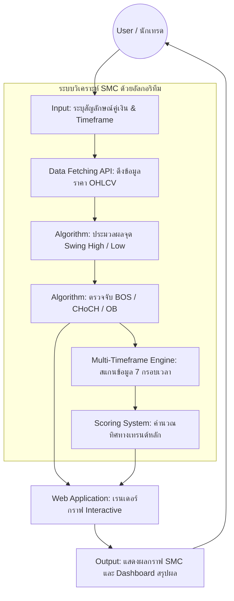

# ข้อเสนอโครงงาน
**เครื่องมือวิเคราะห์และแสดงผลโครงสร้างตลาดการเงินด้วยอัลกอริทึม Smart Money Concepts (SMC)**

---

## 1. ปัญหาและความจำเป็นของโครงการ
**1.1 ที่มาของปัญหา**
นักลงทุนรายย่อยมักประสบปัญหาการขาดทุนจากการขาดความเข้าใจในโครงสร้างตลาดที่แท้จริง ซึ่งได้รับอิทธิพลจากการเคลื่อนไหวของสถาบันการเงินขนาดใหญ่ แนวคิด Smart Money Concepts (SMC) เป็นแนวทางที่ใช้วิเคราะห์โครงสร้างตลาดผ่านองค์ประกอบสำคัญ อย่างไรก็ตาม การวิเคราะห์ด้วยวิธีการแบบดั้งเดิมหรือการตีเส้นด้วยตาเปล่ายังมีข้อจำกัดด้านความไม่เป็นปรนัย (Subjectivity) การใช้เวลาสูง ความเสี่ยงต่อความผิดพลาด และอคติของผู้วิเคราะห์ 

ดังนั้น โครงงานนี้จึงมุ่งพัฒนาเครื่องมืออัตโนมัติด้วยภาษา Python เพื่อวิเคราะห์โครงสร้างตลาดตามหลัก SMC อย่างเป็นระบบ แม่นยำ และลดอคติในการวิเคราะห์ เพื่อสนับสนุนการตัดสินใจและเพิ่มประสิทธิภาพในการศึกษากลยุทธ์การลงทุน

**1.2 ข้อมูลทางสถิติที่แสดงถึงปัญหา**
จากข้อมูลของหน่วยงานกำกับดูแลตลาดการเงินและงานวิจัยพบว่า นักเทรดรายย่อยมีอัตราการขาดทุนเฉลี่ยประมาณ 60–80% อ้างอิงจากรายงานความมั่นคงทางการเงินของ ESMA (European Securities and Markets Authority) [2] สาเหตุสำคัญไม่ได้เกิดจากกลยุทธ์การลงทุนเพียงอย่างเดียว แต่รวมถึงการบริหารความเสี่ยงที่ไม่เหมาะสม และอคติทางอารมณ์ (Emotional Bias) ในการประเมินโครงสร้างตลาด การพัฒนาเครื่องมืออัลกอริทึมอัตโนมัติจึงมีความสำคัญอย่างยิ่งในการช่วยลดข้อผิดพลาดเหล่านี้

---

## 2. นิยามศัพท์เฉพาะ
เพื่อความเข้าใจที่ตรงกันในโครงงานนี้ จึงขอกำหนดนิยามศัพท์เฉพาะดังต่อไปนี้:
*   **SMC (Smart Money Concepts):** แนวคิดและกลยุทธ์การลงทุนที่อ้างอิงจากการติดตามร่องรอยพฤติกรรมการซื้อขายของสถาบันการเงินรายใหญ่
*   **Swing (Swing High / Swing Low):** จุดสูงสุดและจุดต่ำสุดของรอบราคาในช่วงเวลาหนึ่ง ซึ่งเป็นจุดอ้างอิงหลักในการสร้างโครงสร้างตลาด
*   **BOS (Break of Structure):** การทะลุโครงสร้างราคาเดิม (ทะลุ Swing High หรือ Swing Low ก่อนหน้า) เพื่อดำเนินต่อไปในทิศทางของแนวโน้มเดิม
*   **CHoCH (Change of Character):** การเสียรูปทรงของราคา หรือสัญญาณแรกที่บ่งบอกถึงการเปลี่ยนแนวโน้ม (Trend Reversal)
*   **การวิเคราะห์อย่างเป็นปรนัย (Objective Analysis):** การวิเคราะห์ที่อ้างอิงจากกฎเกณฑ์ เงื่อนไขทางคณิตศาสตร์แบบตายตัว (Rule-based Algorithm) โดยปราศจากการใช้ความรู้สึก ทัศนคติ หรืออคติส่วนตัวของผู้ประเมินมาเกี่ยวข้อง

---

## 3. วัตถุประสงค์
3.1 พัฒนาอัลกอริทึมด้วยภาษา Python เพื่อสแกนหาจุด Swing, BOS, CHoCH และ Order Block อย่างเป็นปรนัย
3.2 พัฒนาระบบกระดานข้อมูล (Dashboard) สำหรับสแกนและสรุปแนวโน้มโครงสร้างตลาดในหลายกรอบเวลา (Multi-Timeframe Analysis) อัตโนมัติ
3.3 สร้างเว็บแอปพลิเคชันสำหรับการทำ Backtesting พร้อมแสดงผลข้อมูลผ่านกราฟแท่งเทียนเชิงโต้ตอบ (Interactive Chart) โดยใช้ไลบรารี TradingView Lightweight Charts [3] เพื่อพล็อตโครงสร้าง SMC อัตโนมัติ

---

## 4. ภาพรวมของระบบและอัลกอริทึม
**4.1 แผนภาพการทำงานของระบบ (System Architecture)**

**4.2 อธิบายขั้นตอนการทำงานของระบบ**
1.  **Input:** ผู้ใช้งาน (User) เลือกคู่เงิน (Symbol) ที่ต้องการวิเคราะห์ผ่านหน้าเว็บ
2.  **Process (ขั้นตอนการประมวลผล):** 
    *   ระบบส่งคำขอเพื่อดึงข้อมูลราคาประวัติศาสตร์ (Historical Data) 
    *   อัลกอริทึมแกนหลักทำการเปรียบเทียบแท่งเทียนเพื่อหาจุดกลับตัว (Swing) ตามกฎเกณฑ์ตายตัวทางคณิตศาสตร์
    *   อัลกอริทึมตรวจสอบการเบรกโครงสร้างราคา (BOS/CHoCH) และวาดโซน Order Blocks
    *   ระบบทำการวิเคราะห์โครงสร้างราคาซ้ำใน 7 กรอบเวลา (ตั้งแต่ Weekly จนถึง 5-Minute) เพื่อหาน้ำหนักของเทรนด์ (Multi-Timeframe Analysis)
3.  **Output:** ระบบแสดงผลลัพธ์ผ่านหน้าเว็บ โดยแบ่งเป็น 2 ส่วน คือ (1) กราฟแท่งเทียนที่วาดเส้น SMC ให้อัตโนมัติ และ (2) หน้าต่าง Dashboard สรุปความแข็งแกร่งของเทรนด์พร้อมข้อเสนอแนะ 

**4.3 ฟังก์ชันการทำงานหลักของเว็บแอปพลิเคชัน**
*   **ฟังก์ชันกราฟิก (Charting Function):** แสดงกราฟแท่งเทียน เลื่อน ย่อ-ขยายได้อิสระ
*   **ฟังก์ชันค้นหาโครงสร้างหลัก (Swing & Structure Detection):** ตรวจจับ Swing, BOS, CHoCH อัตโนมัติ
*   **ฟังก์ชันโซนราคา (Price Zone Detection):** ตรวจจับ Order Blocks, FVG (Fair Value Gap) และ Equal High/Low
*   **ฟังก์ชันวิเคราะห์หลายกรอบเวลา (Multi-Timeframe Dashboard):** สรุปสถานะตลาดจากภาพใหญ่ถึงภาพเล็กในหน้าเดียว

**4.4 ลอจิกอัลกอริทึมที่ใช้ในการวิเคราะห์ข้อมูล (Algorithmic Logic)**
แทนที่จะใช้ Machine Learning โครงงานนี้มุ่งเน้นความแม่นยำและการทำซ้ำได้ (Reproducibility) ผ่านการเขียน **Rule-based Algorithm** โดยอาศัย:
*   **Look-back / Look-forward Period:** การเช็คแท่งเทียนก่อนหน้าและแท่งเทียนถัดไป N แท่ง เพื่อยืนยันการเกิดจุด Swing อย่างเป็นปรนัย
*   **Multi-Timeframe Scoring (การประเมินน้ำหนักเทรนด์):** อัลกอริทึมจะประเมินโครงสร้างล่าสุดของแต่ละ Timeframe และให้คะแนนถ่วงน้ำหนัก (Timeframe ใหญ่เช่น สัปดาห์ และวัน จะมีน้ำหนักคะแนนสูงกว่า) หากผลรวมคะแนนสอดคล้องกัน ระบบจะแสดงสัญญาณ (Signal) แนะนำทิศทางที่มีเปรียบ

---

## 5. ประโยชน์ที่คาดว่าจะได้รับ
5.1 ประหยัดเวลาและลดข้อผิดพลาด: มีเครื่องมือ Backtest กลยุทธ์ SMC แบบอัตโนมัติที่ให้ผลเป็นปรนัยโดยไม่ต้องตีเส้นด้วยตาเปล่า
5.2 เพิ่มประสิทธิภาพการตัดสินใจ: ระบบ Dashboard ช่วยประมวลผล Multi-Timeframe อัตโนมัติ ทำให้นักเทรดเห็นภาพรวมตลาดได้อย่างรวดเร็ว ไม่เทรดสวนแนวโน้มหลัก
5.3 เป็นสื่อการเรียนรู้ที่ดี: ช่วยให้ผู้ศึกษากลยุทธ์ SMC มองโครงสร้างราคา (BOS, CHoCH) ได้ถูกต้องตามกฎเกณฑ์อัลกอริทึมเชิงประจักษ์

---

## 6. เกณฑ์ความสำเร็จของโครงการ
โครงการถือว่าประสบความสำเร็จเมื่อระบบสามารถนำเข้า Financial Data มาประมวลผลด้วยอัลกอริทึม และสามารถพล็อตจุดโครงสร้างตลาด (Swing, BOS, CHoCH) รวมไปถึงสรุปแนวโน้มผ่านหน้าเว็บแอปพลิเคชันได้อย่างถูกต้องตามหลักการ SMC 

---

## 7. งานวิจัยและแหล่งอ้างอิงที่เกี่ยวข้อง (References)
1. Babu, A. S., & Reddy, B. K. (2020). Automating Stock Market Structure Analysis using Python. IRJET. https://www.irjet.net/archives/V7/i10/IRJET-V7I1064.pdf
2. ESMA Financial Stability Report. "Retail Trading in Derivatives and CFDs." https://www.esma.europa.eu/press-news/esma-news/esma-adopts-final-product-intervention-measures-cfds-and-binary-options
3. TradingView Lightweight Charts Documentation. https://tradingview.github.io/lightweight-charts/
